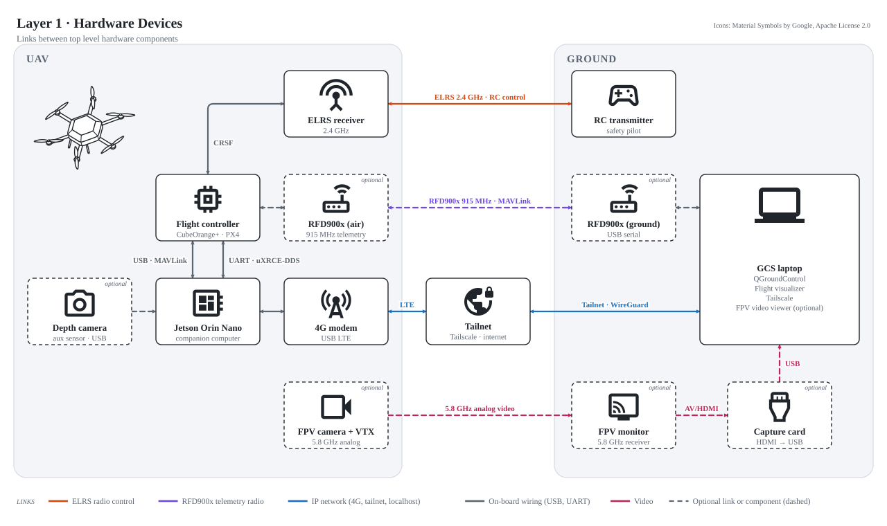
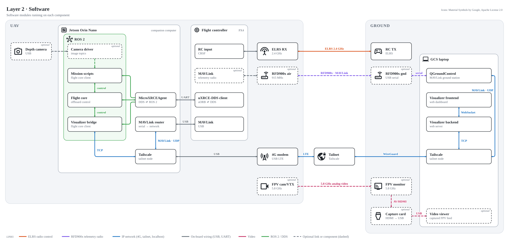
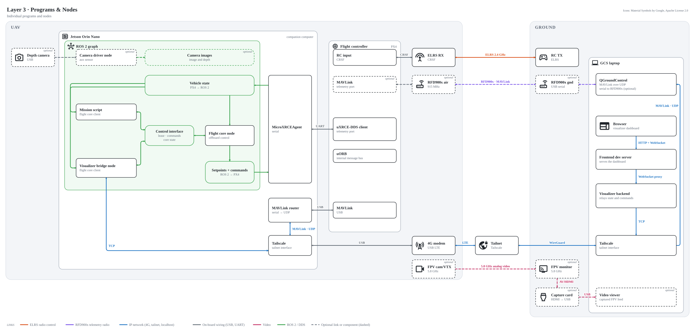
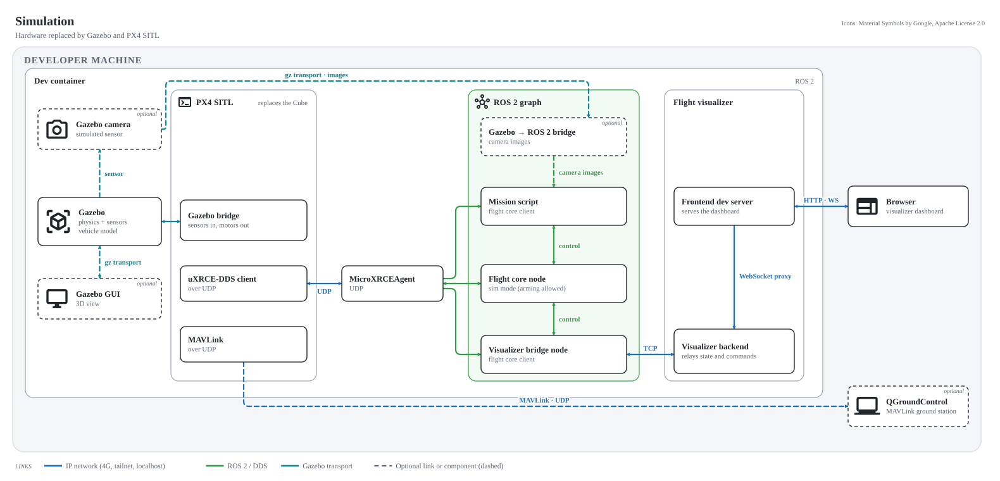

# Communication Links

Back to [flight stack](index.md)

=== "1 · System"

    

=== "2 · Software modules"

    

=== "3 · Programs and nodes"

    

=== "Simulation"

    

<small>Icons: [Material Symbols](https://fonts.google.com/icons) by Google, used under the [Apache License 2.0](https://www.apache.org/licenses/LICENSE-2.0).</small>

!!! note "Editing the diagrams"
    The SVGs in `diagrams/` are generated assets. Edit `media/build_comm_diagrams.py` (layout and labels) or the icons in `media/` (see `media/icons/README.md` for their source and licence), then run `python3 media/build_comm_diagrams.py` from the repository root.
