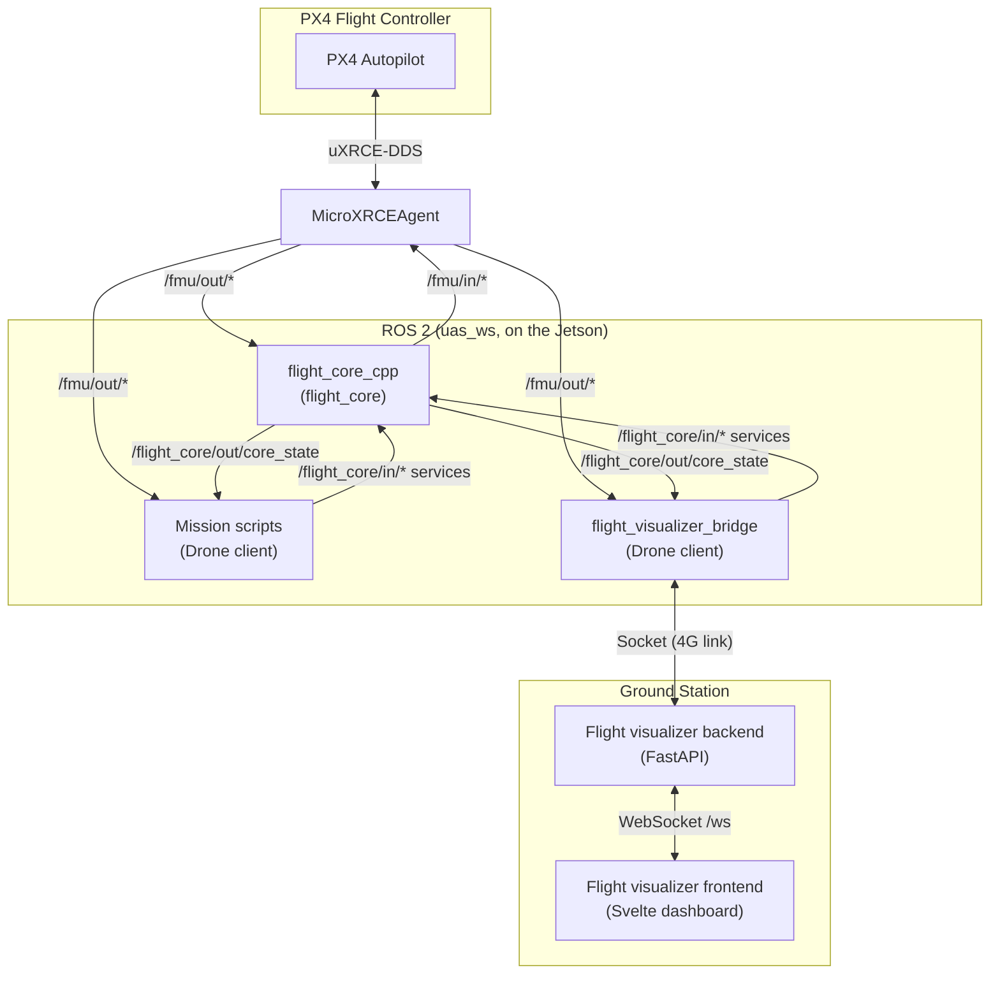
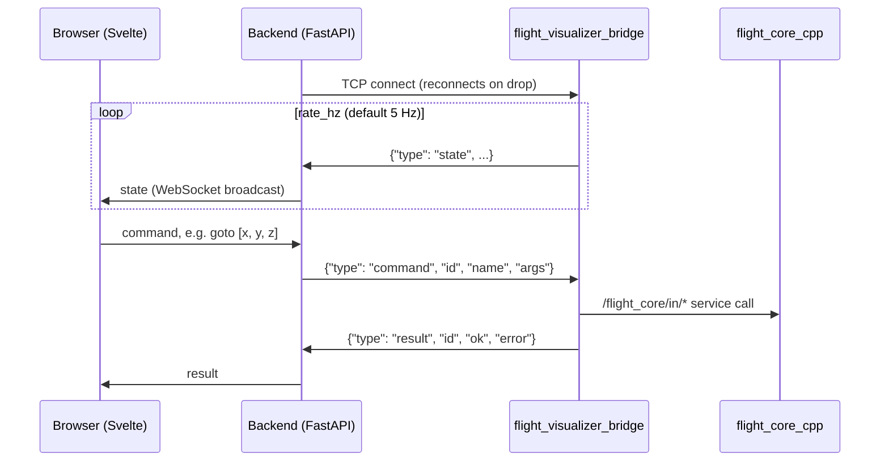
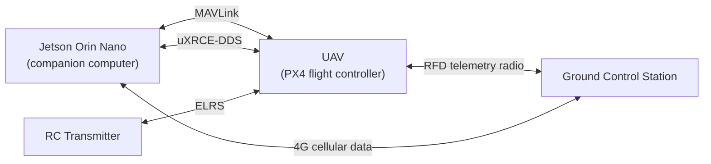

[https://github.com/UTAT-UAS/no_crash](https://github.com/UTAT-UAS/no_crash)

Documentation accurate as of 2026-10-27.

## Codebase Overview

`flight_core_cpp` is the only node that publishes PX4 inputs (`/fmu/in/*`). Clients such as mission scripts and the flight visualizer bridge go through `flight_core`'s services and must hold the control lease to control the vehicle. Clients must read vehicle state directly from PX4's `/fmu/out/*` topics.

### Flight Visualizer

The flight visualizer lets an operator watch and command the drone from a browser.

- The **bridge** runs on the drone. It is also a `Drone` client named `flight_visualizer_bridge`, so commands that move the vehicle need it to hold the control lease (use `reacquire` after a bridge restart).
- The **backend** connects out to the bridge (`BRIDGE_HOST`, `BRIDGE_PORT`), so the ground station must be able to reach the drone over the 4G link. Carrier NAT usually means a VPN is needed.
- The **frontend** connects to the backend's `/ws` WebSocket. `GET /api/state` on the backend returns the link status and latest state for debugging.

## Communication Links

| Link        | Endpoints    | Used for                                                         |
| ----------- | ------------ | ---------------------------------------------------------------- |
| MAVLink     | Jetson ↔ UAV | MAVLink messages between the companion computer and PX4          |
| uXRCE-DDS   | Jetson ↔ UAV | PX4 uORB topics bridged to ROS 2 (`/fmu/in/*`, `/fmu/out/*`)     |
| ELRS        | RC ↔ UAV     | Manual control and mode switching                                |
| RFD         | UAV ↔ GCS    | Telemetry radio link to the ground station                       |
| 4G cellular | Jetson ↔ GCS | Flight visualizer bridge traffic and remote access to the Jetson |
